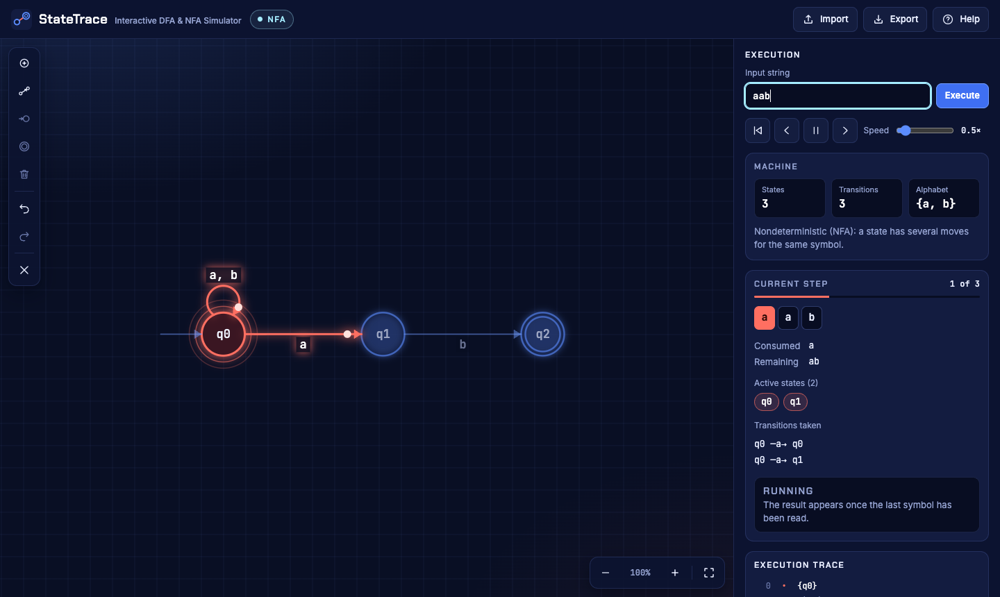

# StateTrace

**Interactive DFA & NFA Simulator.** Draw States. Trace Inputs. Understand Automata.

StateTrace is a browser tool for teaching and learning automata theory. You draw a finite-state machine, type an input string, and watch the machine read it one symbol at a time.

Try it: <https://www.nafees.info/gnu-projects/statetrace>



## What it does

- **Draw machines** on a canvas: states, transitions, self-loops, a start state and accepting states.
- **Trace an input string** with Play, Pause, Next step, Previous step, Reset and adjustable speed.
- **DFA and NFA**: the machine's kind is detected from the diagram. For an NFA, every state the machine could be in is highlighted at once, and a dot travels along each transition taken, so branching is visible. ε-moves are supported.
- **Explain the result**: Accepted or Rejected, with the reason and, when accepted, one accepting path.
- **Report problems** before running: no start state, unlabelled transitions, symbols outside the alphabet, and so on.
- **Export** to PNG, SVG, LaTeX (TikZ) and JSON, and **import** JSON. Every PNG and SVG is signed `Copyright Nafees Mansoor`.
- Undo and redo, zoom and pan, touch input, and a layout that works on phones.

Pushdown automata and Turing machines are not simulated.

## Run it

StateTrace is plain HTML, CSS and JavaScript with no build step.

- Open `index.html` in a browser, or
- serve the folder (needs Node.js 20 or later):

  ```sh
  npm start
  ```

  then open <http://localhost:4173>. Set `PORT` to use another port.

Drawings are saved in the browser's local storage.

## Use it

| Do this | To |
| --- | --- |
| Double-click the board | Add a state, then type its name |
| Shift + drag between two states | Add a transition, then type its symbols |
| Shift + drag inside one state | Add a self-loop |
| Shift + drag from the empty board onto a state | Mark the start state |
| Double-click a state | Toggle accepting |
| Drag a state or a transition | Move it, or bend the arrow |
| Delete (Fn + Delete on a Mac) | Remove the selection |
| Ctrl/Cmd + Z, add Shift to redo | Undo or redo |
| Drag the empty board; pinch or Ctrl/Cmd + scroll | Pan; zoom |

The toolbar on the board does the same without a keyboard. The Help button in the app lists everything.

Transition labels:

| Label | Meaning |
| --- | --- |
| `a` | Read the symbol a |
| `a, b` | Read a or b (each symbol is one character) |
| `\epsilon` or `\lambda` | Move without reading a symbol |
| `q_0`, `\alpha` | Subscripts and Greek letters in names |

## Test it

```sh
npm install
npm test            # simulator logic and the export signature, no browser needed
npm run check:exports   # every PNG and SVG export goes through the signature
npm run test:e2e    # drives the real page in headless Chrome
```

The browser test looks for Chrome in the usual places; set `CHROME_PATH` if yours is elsewhere.

## The export signature

Every exported PNG and SVG carries the line `Copyright Nafees Mansoor`, bottom right, in a strip added under the drawing so it never covers a state or a label. It is not drawn on the board and is not stored in the machine. A PNG also carries it in the file's `Copyright` text field.

All of it lives in `export-protection.js`. The Export dialog's PNG and SVG buttons, Download, Copy and `saveAsSVG()` are the only export routes, and each goes through it:

| Check | When | What it stops |
| --- | --- | --- |
| The signed image is inspected: text, position, size, styling, PNG pixels and file field | On every export | An image that was not signed, or whose signature is hidden, moved or clipped. The dialog shows "Export blocked" and offers nothing to download |
| Download and Copy accept only the image the signed export just made | On every download or copy | An unsigned image reaching the user by another path in the code |
| `npm run check:exports` | Locally and in CI | A new export route, a canvas turned into an image outside the module, the module not loaded, a protected function removed |
| Hashes in `tests/export-integrity.json` | Locally and in CI | A protected function changed without anyone reviewing the export tests |

After changing a protected function on purpose, review the export tests and run `npm run check:exports -- --update`.

**What this does not do.** StateTrace runs in the browser from public, MIT-licensed source. Anyone can edit the code, or the exported file, and remove the signature; the checks above catch mistakes and careless changes to this repository, not a person who sets out to defeat them. LaTeX and JSON exports are text sources and are not signed. A guarantee stronger than this needs exports made by a server you control.

## How it is organised

| File | Role |
| --- | --- |
| `index.html`, `styles.css` | The page and its styling |
| `fsm.js` | The drawing editor: canvas, gestures, view, undo, SVG and LaTeX export |
| `export-protection.js` | Signs and checks every PNG and SVG export; the only code that makes those files |
| `simulator.js` | DFA/NFA logic. No DOM; it turns a machine and an input into a list of steps |
| `simulator-ui.js` | The execution inspector and the animation on the board |
| `workspace.js` | Toolbar, label box, zoom controls, help, import and export |
| `fonts/` | Inter, JetBrains Mono and Chakra Petch (SIL Open Font License) |
| `tests/` | Simulator tests, export signature tests and the browser test |
| `scripts/serve.mjs` | The local server behind `npm start` |
| `scripts/check-exports.mjs` | The static check that no export goes around the signature |

A machine is stored, exported and imported as JSON in this form:

```json
{
  "nodes": [{ "x": 0, "y": 0, "text": "q0", "isAcceptState": false }],
  "links": [
    { "type": "StartLink", "node": 0, "text": "", "deltaX": -90, "deltaY": 0 },
    { "type": "SelfLink", "node": 0, "text": "a, b", "anchorAngle": -1.57 },
    { "type": "Link", "nodeA": 0, "nodeB": 1, "text": "a", "lineAngleAdjust": 0, "parallelPart": 0.5, "perpendicularPart": 0 }
  ]
}
```

## Host or embed it

Copy the files to any static host; nothing runs on a server. If you host your own copy, change the `canonical`, `og:url` and `og:image` addresses in `index.html`, which point at StateTrace's home page.

To embed it, put `index.html` in an `<iframe>`. Inside a frame the workspace is 680px tall; a page on the same origin can change that by setting the CSS variable `--workspace-h` on the frame's root element.

## Credits and license

MIT License, copyright (c) 2019-2026 Nafees Mansoor. See [LICENSE](LICENSE).

The drawing editor is derived from [Finite State Machine Designer](http://madebyevan.com/fsm/) by Evan Wallace, copyright (c) 2010, also MIT. The fonts are under the SIL Open Font License; see [fonts/LICENSE.txt](fonts/LICENSE.txt).
